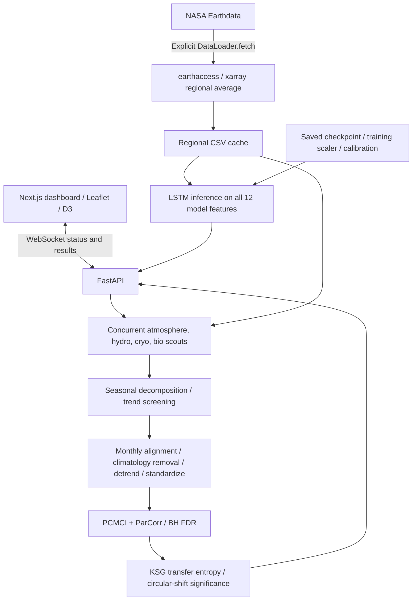
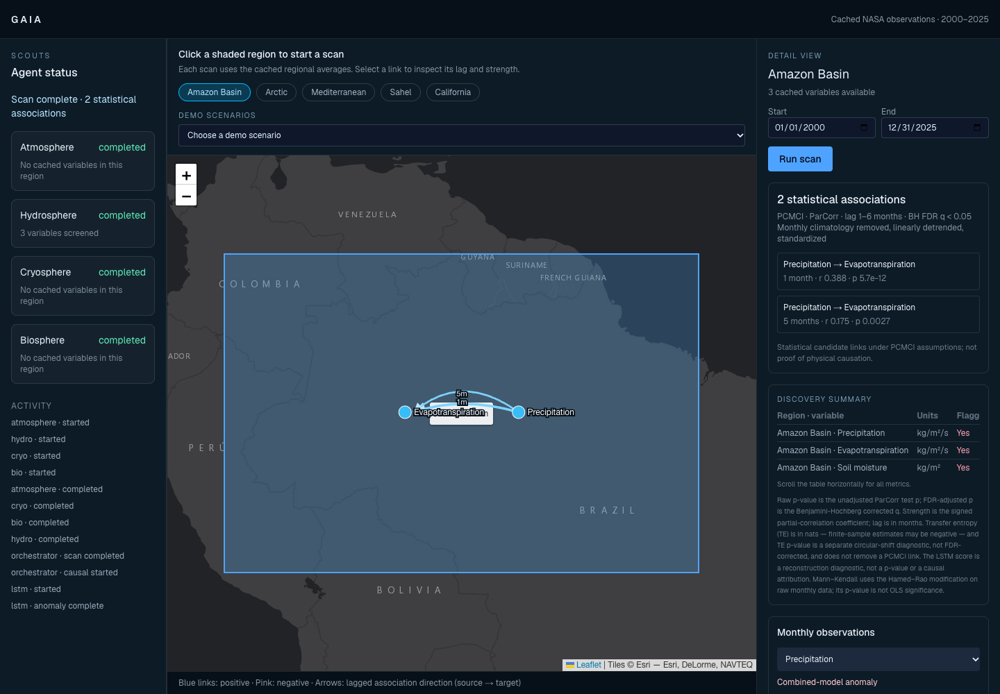

# GAIA

**Geospatial Autonomous Intelligence for Anomaly & Trend Discovery.**

GAIA turns regional Earth-system time series into inspectable trend summaries,
candidate lagged relationships, and reconstruction anomalies. Select a cached
region, watch domain scouts scan its variables, and inspect the resulting graph
and observations. The demo uses real NASA Giovanni regional averages for
2000–2025; each request runs the analysis live.

## Architecture



Blocking scans, PCMCI, and LSTM inference run in worker threads. A request-local
cancel event is set on disconnect and in cleanup. Workers check it between
variables, TE surrogates, and inference batches; a native PCMCI/forward call
already in progress finishes before the next checkpoint. Late results are discarded.

## Technology

| Layer | Tools |
|---|---|
| API and coordination | Python, FastAPI, asyncio, WebSockets |
| Data | NumPy, pandas; optional earthaccess, xarray, h5netcdf, h5py |
| Statistics | SciPy, statsmodels, pyMannKendall, PyWavelets, Tigramite |
| Reconstruction model | PyTorch LSTM autoencoder |
| Interface | Next.js, React, TypeScript, Leaflet, D3, Tailwind |
| Verification | pytest/unittest, FastAPI TestClient, Vitest, Testing Library |

## Local setup

Use Python 3.11+ and Node 22.12+. From the repository root:

```bash
python3 -m venv .venv
.venv/bin/python -m pip install -r backend/requirements-dev.txt
# Enable the saved-model anomaly output:
.venv/bin/python -m pip install -r backend/ml/requirements.txt
./scripts/dev.sh
```

The launcher installs backend/frontend dependencies and starts FastAPI on
`127.0.0.1:8000` and Next.js on `127.0.0.1:3000`. It uses an installed nvm Node 22
when needed. Open **http://127.0.0.1:3000/dashboard**. Ctrl-C stops both services.
Without PyTorch or valid model artifacts, causal scans still work and the API
reports anomaly status `unavailable` with a reason.

The bundled model artifacts live in `backend/ml/saved_models`. Inference needs
the checkpoint and `scaler.npy`; the older bundled checkpoint also uses
`training_summary.json` and `normalized_data.npy` for training-only calibration.
See [ML setup and inference](backend/ml/README.md).

### Optional NASA downloads

```bash
.venv/bin/python -m pip install -r backend/data/requirements.txt
```

Configure [Earthdata Login](https://earthaccess.readthedocs.io/en/latest/user/howto/authenticate/)
through environment credentials or an existing `.netrc`, then call:

```python
from backend.data.loader import DataLoader

loader = DataLoader()
print(loader.list_variables())
values, dates = loader.fetch("Rainf_f_tavg", "amazon", ("2000-01-01", "2025-12-31"))
```

`fetch` first checks the curated `region_variable.csv` and an exact date-range
cache. Missing coverage triggers a search of the specified product/version,
download, and cosine-latitude-weighted regional average from a regular CF
latitude/longitude grid. It returns calendar-month means and dates. Fill values
are masked; missing months are rejected. Rates retain their units. Downloads
use whole months and may retrieve full global granules; this is not a server-side
spatial subset. No interactive credential prompt runs in a request.

Downloaded interval CSVs are kept separately from curated exports. Dashboard
scouts use curated files only; inspect provenance and coverage before promoting
a downloaded interval to a curated `region_variable.csv`. This also avoids
silently changing the training features or the published demo results.

## API and configuration

| Route | Purpose |
|---|---|
| `GET /health` | API readiness and configured scout count |
| `GET /regions` | Region bounds, cached variables, demo dates |
| `GET /variables` | Variable descriptions, units, dataset short names/versions |
| `WS /ws/scan` | One scan per connection: status events, then complete/error |

Send:

```json
{"regions":["amazon"],"date_range":["2000-01-01","2025-12-31"]}
```

The complete response contains `links`, `discoveries`, `discovery_count`,
`n_samples`, `n_variables`, `tau_max`, `fdr_applied`, `method`, `preprocessing`,
and additive `anomalies`. Each link includes cause/effect node IDs, lag,
strength, raw `p_value`, `corrected_p`, `te`, and `te_p`. Discoveries retain raw
dates, values, trend statistics, and source metadata. `n_samples` counts aligned
monthly rows before lag trimming.

Anomalies provide timestamp-aligned errors and flags, fixed threshold, training
mean/std, feature names, and overlap counts. Their `scope=all_model_features`
means a combined score over all 12 features in five regions, even for a single
region scan. They do not attribute an event to that region. Scores use the
selected date interval; changing its boundaries can change overlapping windows.
See the exact [Cursor integration contract](docs/cursor-handoff.md).

- `NEXT_PUBLIC_API_URL`: frontend backend URL; set before building the frontend.
- `GAIA_ALLOWED_ORIGINS`: comma-separated frontend origins (localhost/127.0.0.1
  port 3000 by default); applies to HTTP CORS and WebSocket origins.
- `GAIA_PCMCI_PC_ALPHA`: PC1 parent-selection threshold, default `0.2`.
- `GAIA_MODEL_PATH`: optional alternative checkpoint; companion artifacts must match.
- `GAIA_VENV_DIR`: optional environment path used by the development launcher.

## NASA datasets

| Source product | Cached measurements |
|---|---|
| [GLDAS_NOAH025_M v2.1](https://hydro1.gesdisc.eosdis.nasa.gov/data/GLDAS/GLDAS_NOAH025_M.2.1/) | Precipitation rate, shallow soil moisture; a separate Amazon surface-runoff export |
| [GLDAS_NOAH025_3H v2.1](https://hydro1.gesdisc.eosdis.nasa.gov/data/GLDAS/GLDAS_NOAH025_3H.2.1/) | Evapotranspiration, averaged to months |
| [M2T1NXSLV v5.12.4](https://goldsmr4.gesdisc.eosdis.nasa.gov/data/MERRA2/M2T1NXSLV.5.12.4/) | Two-meter air temperature, averaged to months |
| [M2TMNXLND v5.12.4](https://goldsmr4.gesdisc.eosdis.nasa.gov/data/MERRA2_MONTHLY/M2TMNXLND.5.12.4/) | Snow mass |
| [M2TMNXSLV v5.12.4](https://disc.gsfc.nasa.gov/datacollection/M2TMNXSLV_5.12.4.html) | Mediterranean monthly two-meter air temperature |
| [FLDAS_NOAH01_C_GL_M v001](https://doi.org/10.5067/5NHC22T9375G) | Sahel monthly evapotranspiration |

The cache covers Amazon, Sahel, Arctic, Mediterranean, and California with
different variable availability. Inspect each CSV's dataset identifier and
actual bounding box; labels do not guarantee identical spatial coverage. No
biosphere series is currently curated. [Giovanni](https://giovanni.gsfc.nasa.gov/giovanni/)
produces the regional exports used by the demo.
The download catalog preserves the Sahel FLDAS ET and Mediterranean monthly
MERRA-2 temperature overrides; `GET /variables` exposes these as `regional_sources`.

## Scientific methodology

1. **Trend and Mann–Kendall/Sen:** additive seasonal decomposition with period 12;
   OLS on the deseasonalized series. The current implementation uses Hamed–Rao
   modified Mann–Kendall on raw monthly values (except a constant/seasonal-only
   special case); Sen slope follows that test input. Scouts flag significant
   trends or detrended residual magnitude of at least 2.5 standard deviations.
2. **BOCPD:** Normal–Inverse–Gamma model with Student-t predictive probabilities,
   log-space run-length filtering, and heuristic candidate boundary extraction.
   Default scouts run standardized deseasonalized observations through streaming updates,
   expose calendar dates, and check cancellation between observations. The dashboard
   labels these as exploratory candidate boundaries.
3. **Wavelets:** db4 discrete approximation/detail decomposition and Morlet CWT
   power. Edge artifacts remain; power is not a calibrated power spectral density.
4. **PCMCI:** aligned flagged variables independently lose monthly climatology
   and linear trend, then are standardized. ParCorr, lags 1–6 months,
   `pc_alpha=0.2`; Benjamini–Hochberg FDR over lagged tests, retaining q < 0.05.
   Self-links mean identical variable **and** region; other regions remain eligible.
5. **Transfer entropy:** KSG conditional mutual information with Chebyshev
   distance, k=5, history length 2, and strict-radius marginal counts. Only
   FDR-surviving links run TE. Significance uses 200 circular source shifts,
   `(1 + count(surrogate >= observed))/201`. TE is an additional bivariate
   diagnostic; its p-value is not FDR-corrected or another link filter.

The **LSTM autoencoder** adds retrospective reconstruction MSE. Training and
validation are split chronologically before making windows; normalization and
the mean + 2σ threshold use training data only. Overlapping window scores are
averaged per month. The bundled full-period demo includes training observations,
so it is not an independent anomaly benchmark or forecast.

`validate_water_balance(P, ET, Q, dS)` reports signed mean residual and mean
absolute relative error with plain-English interpretation, without pass/fail.
Inputs must have matching intervals, spatial coverage, and units. Amazon now
has storm surface runoff, but total runoff (including subsurface flow) and
storage change are incomplete; shallow soil moisture is not total storage.
The real-data check remains **inputs unavailable**. See [input inventory](reports/physics-inputs.md).

These statistical relationships are candidate explanations, not proof of
physical causation. Selection effects, common drivers, product mismatch, and
autocorrelation require further evaluation. See the [causal audit](reports/causal-audit.md)
and [analysis interfaces](backend/analysis/README.md).

## Demo scenarios and results

Choose Amazon Water Cycle or Sahel Water Cycle, use 2000–2025, scan, then inspect
rainfall → evapotranspiration. Amazon retains lags 1 and 5; Sahel retains lag 1.
The Amazon lag-1 TE diagnostic is significant at 0.05; the lag-5 and Sahel TE
diagnostics are not. Present this disagreement rather than hiding it.

Five full TestClient WebSocket scans per scenario reproduced identical results.
The combined model flags 19 of 312 months at threshold 0.256064 in both scans
because the model input includes all five regions. These are not 19 independent
regional findings. [Measured results](reports/demo-rehearsal.json) and
[project summary](docs/project-summary.md) contain the numbers.

## Screenshots and presentation



[Association details](reports/browser/amazon-detail.png) ·
[Anomaly chart](reports/browser/amazon-anomalies.png) ·
[Mobile dashboard](reports/browser/sahel-mobile.png)

[30-second demo](deliverables/gaia-demo-30s.mp4) ·
[12-slide browser pitch](deliverables/gaia-pitch.html) ·
[PDF slides](deliverables/gaia-pitch.pdf) ·
[Three-minute script](deliverables/pitch-script.md)

## Verification

```bash
.venv/bin/python -m pytest backend/analysis/tests backend/agents/tests backend/data/tests backend/ml -q
.venv/bin/python -m scripts.rehearse_demos
# With the backend running on port 8000, using Node 22:
cd frontend
npm test
npm run build
```

Loader tests use real synthetic NetCDF files and mocked Earthdata transport.
Frontend tests use JSDOM with real Leaflet click handlers, D3, and the live API;
they do not verify browser layout, map-tile loading, or browser console output.
The older `backend/test_bocpd.py` and `backend/test_pcmci.py` are manual plotting
scripts, not the automated regression suite.

## Future work and handoff

- Anomaly bands, discovery summary table, and metric help are implemented;
  18 frontend tests, the production build, and real Chrome checks pass.
  [Browser acceptance](reports/browser-acceptance.md).
- Complete compatible water-balance inputs and interpret residuals without a
  hard closure threshold; validate external data downloads against real products.
- Add independent held-out anomaly evaluation and region/variable attribution.
- BOCPD candidate dates now appear in scout summaries and the dashboard.
  They do not change screening flags, causal thresholds, or LSTM scores.
- Public hosting is optional and intentionally skipped. If later needed, deploy
  FastAPI/Next.js, configure origins/API URL, and verify WSS/live scans.
  The demo recording and pitch are ready for rehearsal and final submission.
- Expand datasets, causal assumptions/robustness checks, and spatial uncertainty.

## Final local release

The final release passes 195 backend tests (plus 9 subtests), 18 frontend tests,
and the production build. Five scans per demo reproduce the same results.
See [release verification](reports/release/verification.md).

Run `./scripts/demo.sh` for a production demo using installed dependencies and
the built frontend. It reuses healthy local services and starts missing ones.
The self-contained browser deck includes the 30-second video and speaker notes.
Edit `scripts/presentation/deck.html`, then run `node scripts/presentation/build.mjs`
to rebuild it and the script from measured data and local assets.
